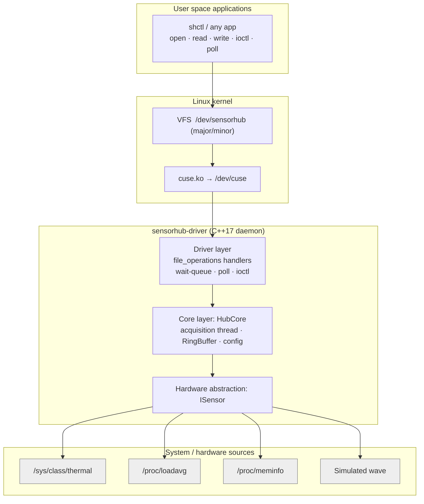

# Architecture

SensorHub is a **layered, event-driven software architecture** with a clear
hardware-abstraction boundary. Each layer only talks to the layer below it.

## Layers

| Layer | Files | Responsibility |
|---|---|---|
| Application | `src/cli/shctl.cpp` | User tool; demonstrates every syscall on the device |
| ABI | `include/sensorhub/abi.hpp` | Shared structs + ioctl numbers (the "driver contract") |
| Driver | `src/driver/main.cpp` | CUSE entry points, blocking-read queue, poll wake-ups, ioctl copy-in/out |
| Core | `src/core/hub_core.cpp`, `ring_buffer.hpp` | Sampling thread, buffering, config validation, stats |
| HAL | `src/core/sensors.cpp`, `sensor.hpp` | `ISensor` interface + 4 implementations, factory |

## Design patterns used
* **Strategy / Interface** – `ISensor` hides each data source (hardware abstraction).
* **Factory** – `make_sensor(id)`.
* **Observer** – `HubCore::Listener` notifies the driver layer after each tick.
* **Producer–Consumer** – acquisition thread (producer) → ring buffer → readers.
* **Separation of concerns** – the core has zero FUSE code, so it is unit-tested directly.

## Data flow (blocking read)
1. App calls `read(fd, buf, n)`; VFS → CUSE → daemon `shub_read()`.
2. Data available → `fuse_reply_buf()` immediately.
3. Empty + `O_NONBLOCK` → `-EAGAIN`.
4. Empty + blocking → request is queued in `pending` (the wait queue); the process sleeps in the kernel.
5. Acquisition thread produces samples → listener → `service_waiters()` completes the queued read and wakes pollers.
6. Process interrupted by a signal → request flagged interrupted → completed with `-EINTR`.

## Concurrency model
| Thread | Role |
|---|---|
| FUSE loop thread | Handles open/read/write/ioctl/poll requests |
| Acquisition thread | Reads sensors every `period_ms`, pushes into the ring buffer |

Locks: `RingBuffer::m_` (data), `HubCore::m_` (config/flags), `HubCore::poll_m_`
(sensor access), `HubCore::lifecycle_m_` (start/stop), `Driver::m` (wait queue).
Lock order is always `Driver::m → ring mutex`; the core never calls the listener
while holding a lock, and `stop()` is never called with `Driver::m` held, so
there are no lock-order inversions. Verified with ThreadSanitizer.

## Buffer policy
Fixed capacity, **overwrite-oldest**: a slow reader sees the freshest data and
`dropped` in `Stats` makes data loss observable instead of silent.
